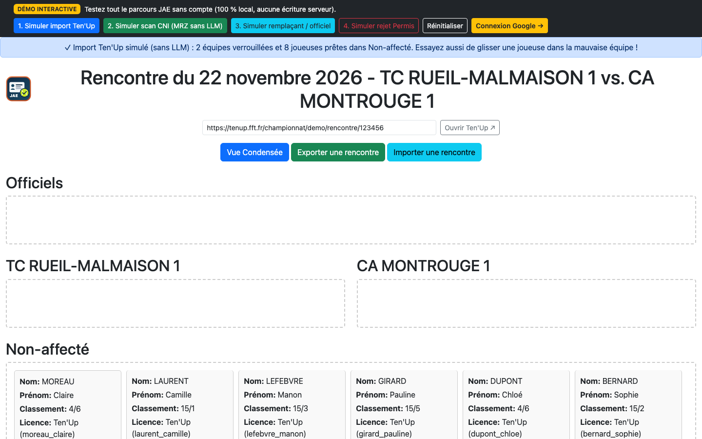
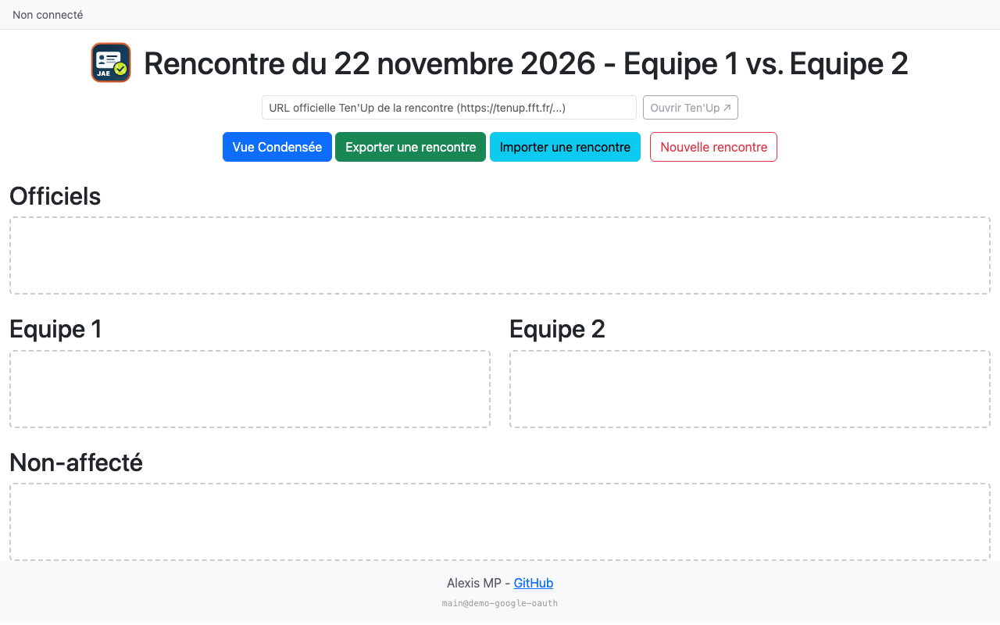
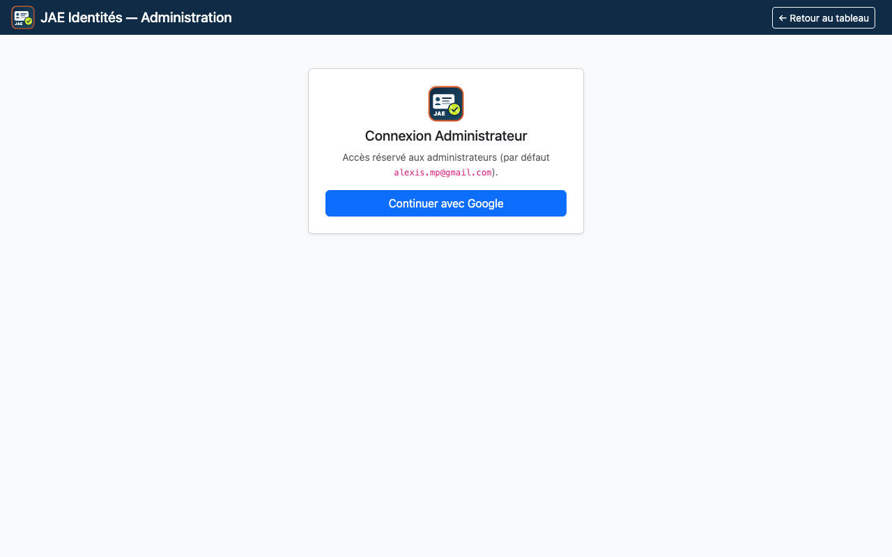

  

<h1 align="center">JAE Identités</h1>

  <strong>Préparation de rencontre et vérification rapide des identités pour les Juges-Arbitres par Équipe (JAE).</strong> 
  <a href="https://jae-ocr-2500276981.europe-west1.run.app/demo"><strong>Essayer la démo interactive (sans connexion) →</strong></a>

> **Note importante :** Ce projet est un développement personnel et n'est en aucun cas affilié à la Fédération Française de Tennis (FFT). Il est uniquement conçu pour faciliter la phase de vérification des identités lors des rencontres par équipe.

---

## Les différents scénarios d'utilisation

Selon la manière dont la rencontre est préparée (avec ou sans Ten'Up), **JAE Identités** s'adapte à trois usages courants le jour du match :

### 1. Composition d'équipe complète importée depuis Ten'Up (cas le plus rapide)
Lorsque la liste Ten'Up de chaque équipe contient tous les joueurs et joueuses susceptibles de disputer la rencontre :
1. Depuis la page officielle de la rencontre sur Ten'Up, cliquez sur l'extension Chrome **JAE Ten'Up** : les noms des deux clubs sont renseignés et verrouillés, et toutes les fiches sont créées dans **Non-affecté**.
2. Au bord du court, vous n'avez plus besoin de scanner les licences — scannez uniquement les **pièces d'identité** (CNI ou passeport).
3. Dès qu'une pièce est validée, sa case *Pièce d'identité* se coche et la fiche bascule automatiquement dans la colonne de son équipe.

### 2. Mode mixte : équipe importée depuis Ten'Up + remplaçant(e) hors liste ou officiel
En championnat par équipes (par exemple des équipes de 4 joueurs/joueuses), il arrive qu'un nouveau joueur ou une nouvelle joueuse **absent(e) de la liste initiale** vienne compléter l'équipe (avec un classement moindre), ou qu'il faille contrôler un **officiel** :
1. Importez normalement la rencontre depuis Ten'Up pour pré-remplir les titulaires connus.
2. Pour toute personne absente de la liste (remplaçant(e) ou officiel), scannez **son attestation de licence FFT** (papier ou écran Ten'Up) **ainsi que sa pièce d'identité** (une pièce d'identité seule sans licence ni présence dans la liste Ten'Up ne crée pas de fiche).
3. Sa fiche apparaît dans **Non-affecté** avec sa case *Pièce d'identité* cochée automatiquement : il ne reste qu'à la glisser dans la colonne de son équipe ou dans **Officiels**.

### 3. Mode autonome sans extension Chrome (scan des licences + pièces d'identité)
Si vous ne souhaitez pas utiliser l'extension Chrome (ou sans accès à Ten'Up) :
1. Scannez les **attestations de licence FFT** (ou écrans Ten'Up) et les **pièces d'identité** de chaque participant avec l'application Android ou le scanner web.
2. Chaque licence crée une fiche dans **Non-affecté**, et chaque pièce d'identité coche automatiquement la case *Pièce d'identité* correspondante.
3. Glissez les fiches dans **Équipe 1**, **Équipe 2** ou **Officiels** : la première fiche déposée dans une équipe renomme automatiquement la colonne avec le nom de son club.

Dans tous les scénarios, le tableau de bord se synchronise en temps réel entre plusieurs écrans (ordinateur, tablette), empêche de déposer par erreur une personne dans la mauvaise équipe, et permet d'exporter/importer une rencontre ou d'en démarrer une nouvelle.

## Règles de contrôle, comptes & confidentialité

- **Accès nominatif Google OAuth uniquement (sans mot de passe)** : chaque Juge-Arbitre se connecte exclusivement via **Google** (Firebase Authentication) ; aucun mode anonyme ni mot de passe n'est autorisé. Les nouveaux comptes doivent être **approuvés par l'administrateur** avant de pouvoir accéder à l'application. Pour découvrir le fonctionnement sans compte, une **[démo interactive en ligne](/demo)** est accessible librement (100 % locale, sans écriture serveur).
- **Une seule rencontre active par JAE, plusieurs rencontres en parallèle** : plusieurs Juges-Arbitres peuvent utiliser l'application simultanément sur des rencontres différentes. Chaque JAE ne gère qu'une seule rencontre active à la fois (identifiée dans l'URL `/m/<identifiant>` pour conserver la session au rafraîchissement), et démarrer une *Nouvelle rencontre* archive proprement la précédente.
- **Pièces d'identité acceptées uniquement** : **Cartes Nationales d'Identité (CNI)** (ancien ou nouveau format, françaises ou étrangères) et **Passeports**. Les **permis de conduire** et **titres/cartes de séjour** sont automatiquement refusés.
- **Analyse locale en priorité (sans envoi de photo)** : à chaque fois que c'est possible, la lecture se fait **directement sur votre appareil** (lecture locale des équipes dans Chrome, lecture locale de la bande MRZ des CNI et passeports sur Android). **Aucune photo n'est alors envoyée au serveur** et la validation s'effectue en moins d'une seconde.
- **Analyse serveur de secours uniquement si besoin** : une photo compressée n'est envoyée au serveur que lorsque la lecture locale ne suffit pas (par exemple un recto seul de nouvelle CNI sans bande MRZ, une carte difficile à lire, ou une attestation de licence FFT scannée à la main).

## Aperçu visuel

### Tableau de bord de rencontre (mode démo interactif)

### Connexion Juge-Arbitre (Google OAuth) & Console d'administration (`/admin`)
| Connexion Juge-Arbitre | Console d'administration dédiée (`/admin`) |
| :---: | :---: |
|  |  |

## Documentation technique par module

Tous les détails techniques (architecture, endpoints, déploiement Cloud Run, compilation Android, tests) sont regroupés dans les quatre modules du projet :

| Module | Rôle | Documentation technique |
| :--- | :--- | :--- |
| **Application Android (`jae-scanner-android`)** | Scan rapide au bord du court, lecture locale MRZ sans photo, rejet local permis/séjour, historique des actions | [jae-scanner-android/README.md](jae-scanner-android/README.md) |
| **Extension Chrome (`jae-tenup-extension`)** | Import en 1 clic des deux équipes depuis Ten'Up directement dans le navigateur | [jae-tenup-extension/README.md](jae-tenup-extension/README.md) |
| **Tableau de bord & OCR (`jae-ocr`)** | Interface web synchronisée multi-machines, validation directe et analyse de secours sur le cloud | [jae-ocr/README.md](jae-ocr/README.md) |
| **Scanner Web mobile (`jae-scanner`)** | Scanner web de secours utilisable depuis n'importe quel navigateur mobile | [jae-scanner/README.md](jae-scanner/README.md) |
